# 采集数据图解

> 本地数据快照：**I2RT YAM 双臂 · 人工遥操作 · NEDF3 / Protobuf / MCAP · i2rt-nedf3-v2**。
> 全量检查 81 份 metadata、统计与分片数量；两个任务各抽查 `episode_0001` 的 MCAP。未启动硬件。

## 1. 数据规模

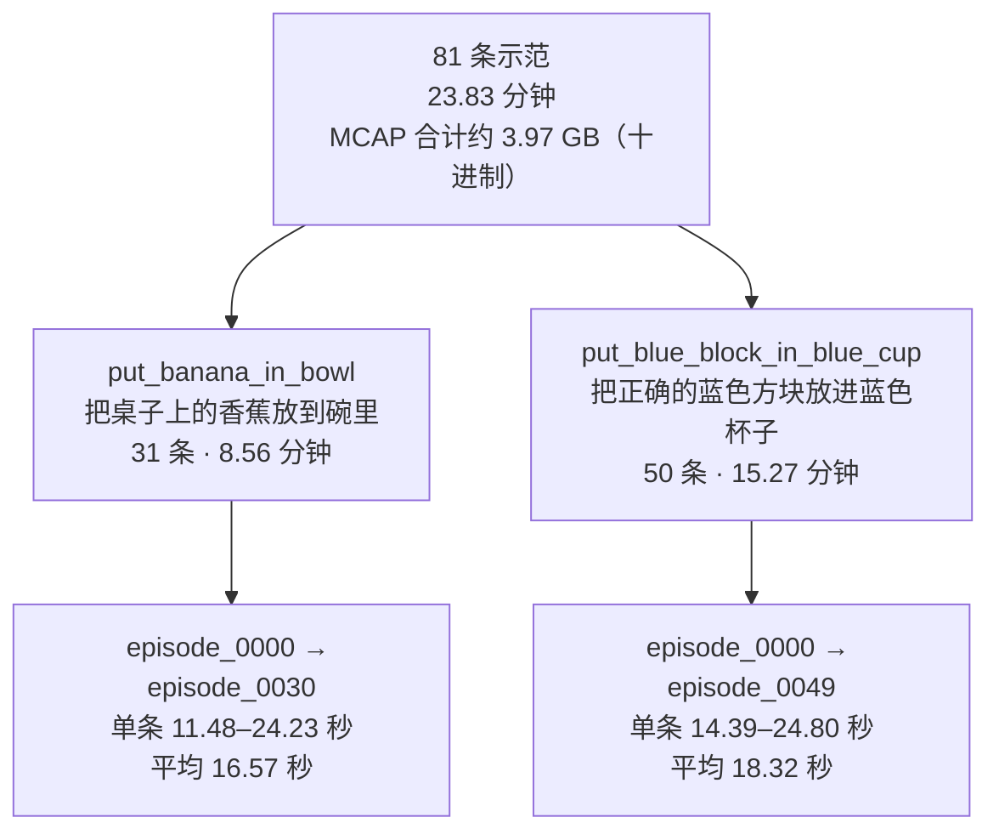

## 2. 这些数据从哪里来？

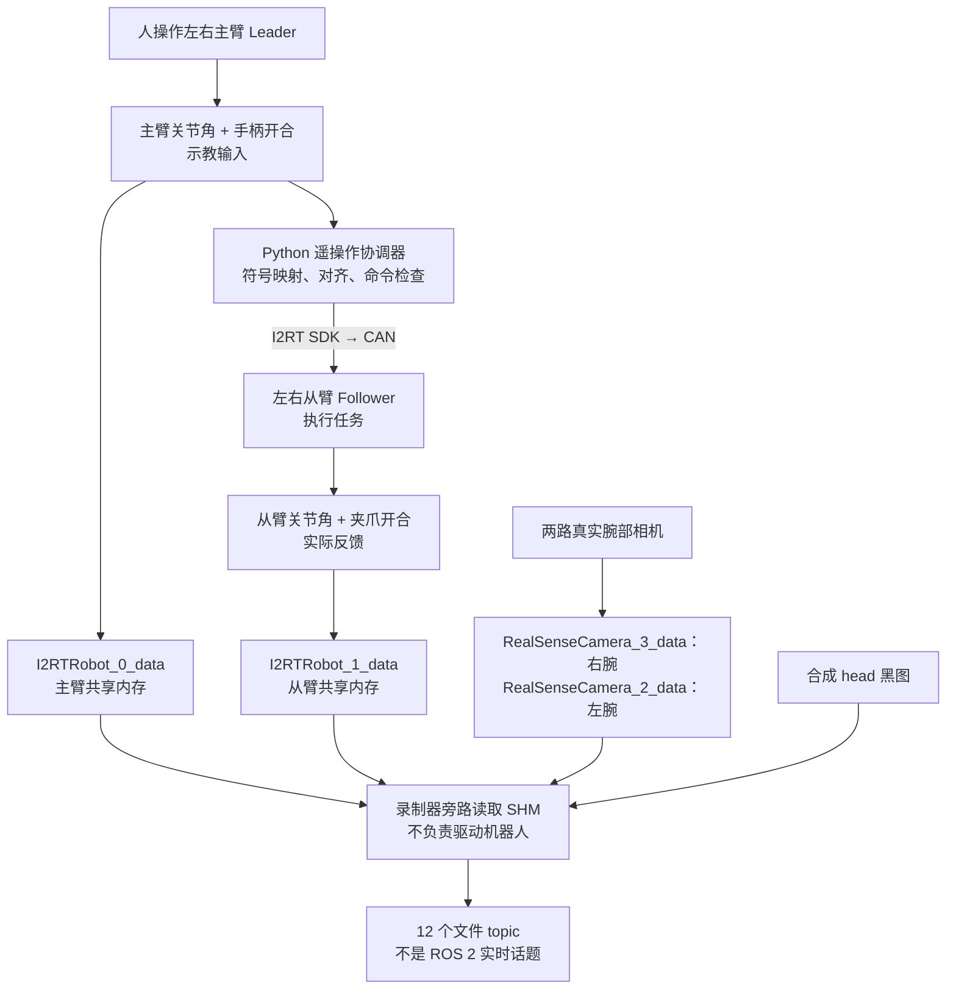

**主臂状态 ≠ 最终下发命令；从臂状态是反馈，不是目标。** 本批没有模型参与。

## 3. 目录里每个文件做什么？

```text
data/
├── data_collection_guide.md       本文
├── put_banana_in_bowl/
│   └── episode_0000/ ... episode_0030/
└── put_blue_block_in_blue_cup/
    └── episode_0000/ ... episode_0049/
        ├── metadata.json         任务、硬件描述、相机角色、契约
        ├── episode_stats.json    时长、topic 数量、丢批、写入错误
        └── data/
            ├── mcap_index.json   分片文件名、时间范围、topic 列表
            └── data_<ns>_0.mcap  真实消息；当前每条示范一个分片
```

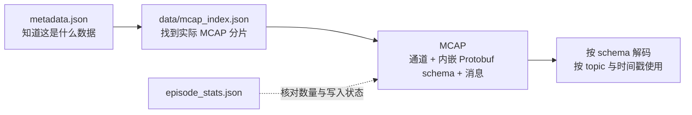

`metadata.mcap_file_name` 虽写 `data.mcap`，**实际文件以索引为准**；不要硬编码这个文件名。

## 4. 机器人状态：左右、主从、单位

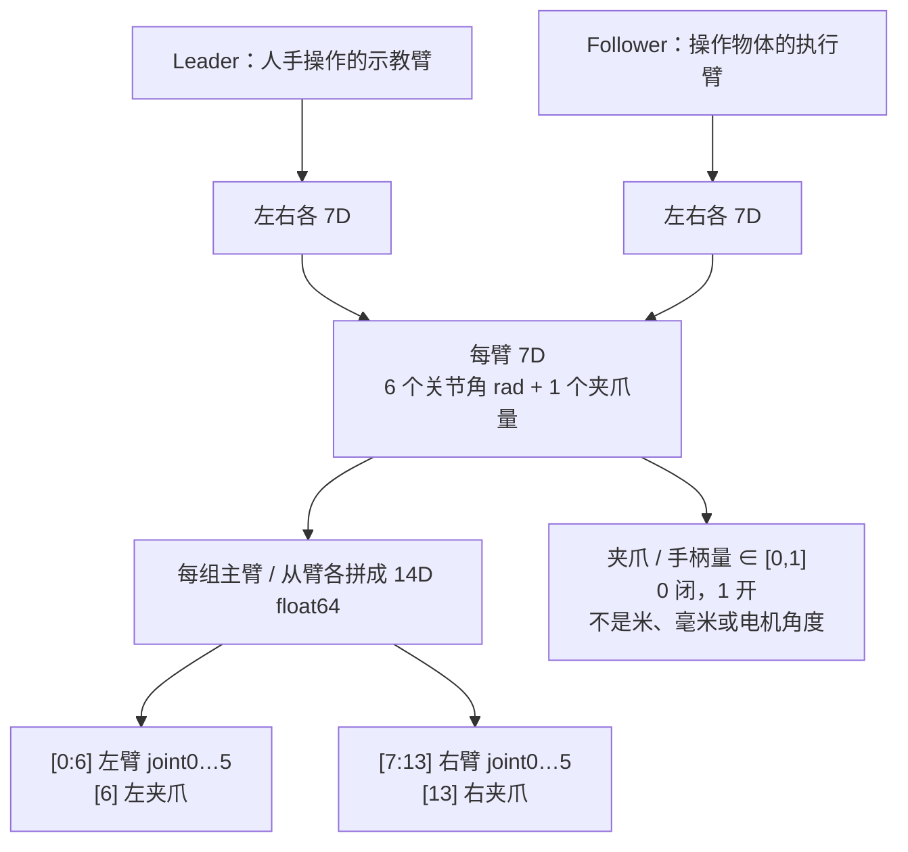

14D 是**源 SHM 布局**；写文件后拆成左右关节与夹爪的独立 topic，文件中不是每条消息都带完整 14D。

## 5. 全部 12 个 topic

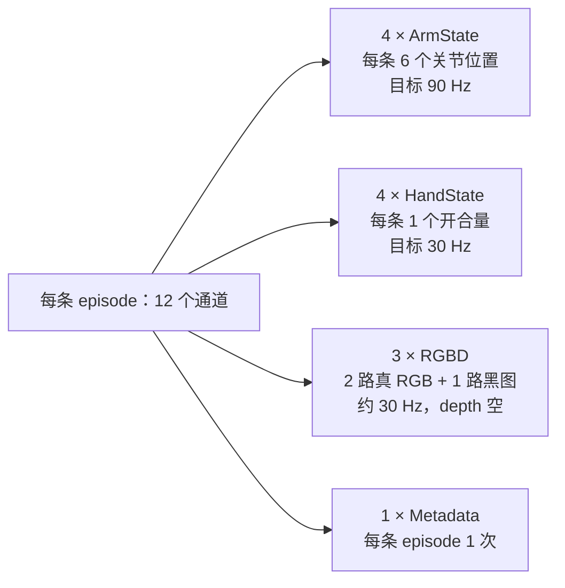

名称**没有前导斜杠**：

| 完整 topic | 来源 / 含义 |
|---|---|
| `nmx/nedf/metadata` | 版本与 episode 元信息 |
| `nmx/hal/i2rt/leader/left/joint` | 左主臂 6 关节 |
| `nmx/hal/i2rt/leader/right/joint` | 右主臂 6 关节 |
| `nmx/hal/i2rt/follower/left/joint` | 左从臂 6 关节 |
| `nmx/hal/i2rt/follower/right/joint` | 右从臂 6 关节 |
| `nmx/hal/i2rt/leader/left/hand_state` | 左主臂手柄开合输入 |
| `nmx/hal/i2rt/leader/right/hand_state` | 右主臂手柄开合输入 |
| `nmx/hal/i2rt/follower/left/hand_state` | 左从臂夹爪开合反馈 |
| `nmx/hal/i2rt/follower/right/hand_state` | 右从臂夹爪开合反馈 |
| `nmx/hal/camera/camera_0/rgbd` | 右腕真实 RGB |
| `nmx/hal/camera/camera_1/rgbd` | 左腕真实 RGB |
| `nmx/hal/camera/camera_2/rgbd` | head 黑图占位 |

### 消息字段

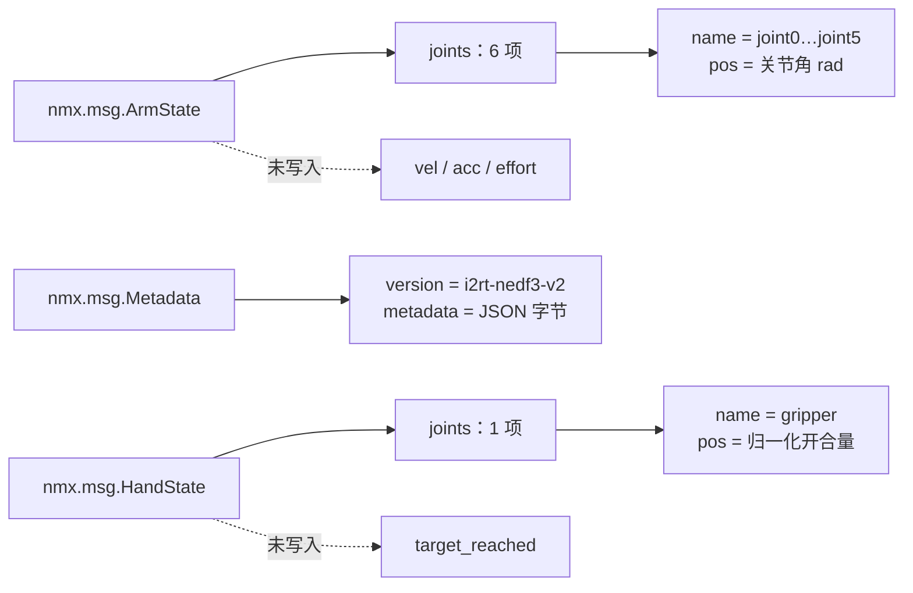

**Protobuf 默认 0 / false 不代表实测值。** schema 中有某个字段或类型，也不代表采集过相应数据。

## 6. 图像到底是什么？

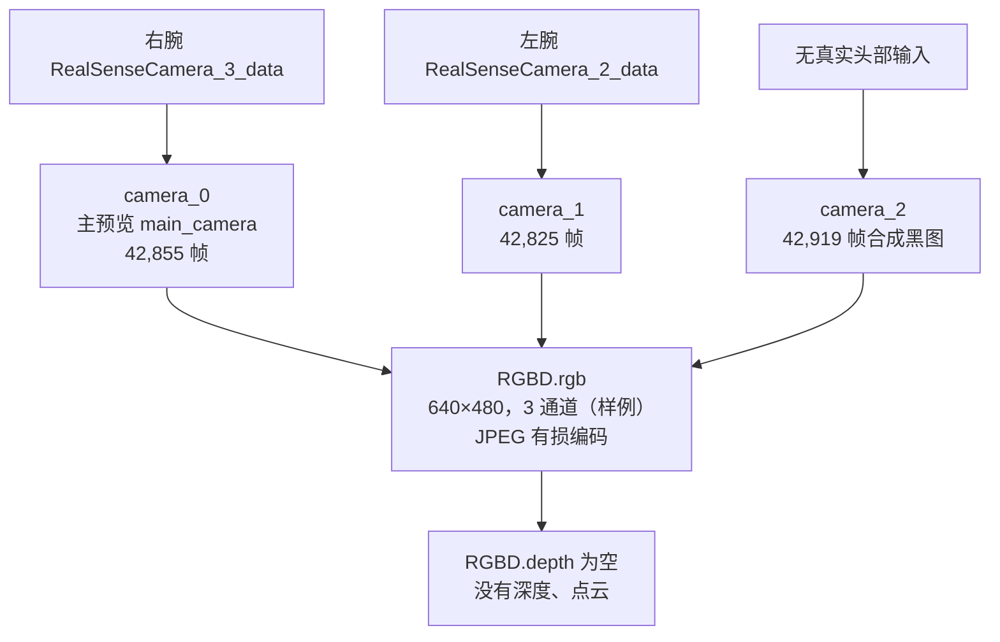

```text
共享内存：RGB uint8 [H,W,3]
    ↓ RGB → BGR（仅适配 OpenCV 编码接口）
JPEG 编码 → RGBD.rgb.data
    ├── rows / cols / channels：图像尺寸
    ├── type：ENCODED
    └── encoded_format：jpeg

RGBD.depth：rows=cols=channels=0，data 为空
RGBD.depth_scale=1.0：不代表记录了深度
```

当前录制器保留原始尺寸、不裁剪缩放，默认 JPEG quality 90；样例元数据标注图像变换为 `none`。v2 不需要历史 v1 的红蓝通道修复；用 OpenCV 解码得到 BGR 时，再按使用方要求转换 RGB。

## 7. 采样与时间对齐

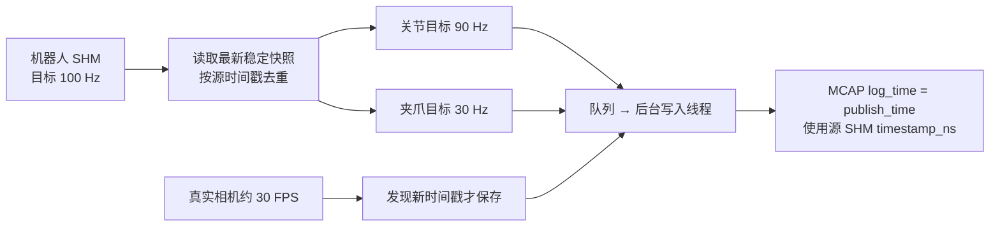

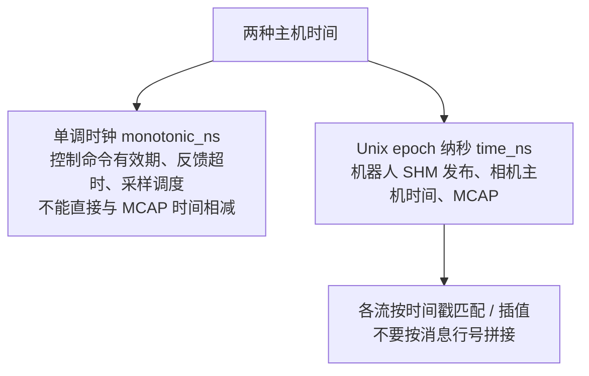

- 同一 14D 快照拆出的左右消息共享时间；机器人时间是**协调器发布时间**，不代表四臂硬件同时采样。
- 相机使用主机 Unix 时间，不是 RealSense 原始设备相对毫秒；图像和机器人没有硬件同步保证。
- 100 → 90 Hz 本身就是选帧；`dropped_batches=0` 不代表全部源帧都保存。
- `duration_s` 来自 episode 开始到结束收尾的主机时间，可能含排空队列/关闭 writer 的耗时；不必等于 MCAP 首末消息时间差。

## 8. 消息数量

| 数据流 | 香蕉任务 | 蓝块任务 | 合计 |
|---|---:|---:|---:|
| 每个独立 joint topic | 46,226 | 82,450 | 128,676 |
| 4 个 joint topic 合计 | 184,904 | 329,800 | 514,704 |
| 每个独立 hand_state topic | 15,416 | 27,503 | 42,919 |
| 4 个 hand_state topic 合计 | 61,664 | 110,012 | 171,676 |
| camera_0 右腕 | 15,400 | 27,455 | 42,855 |
| camera_1 左腕 | 15,384 | 27,441 | 42,825 |
| camera_2 黑图 | 15,416 | 27,503 | 42,919 |
| metadata | 31 | 50 | 81 |

**真实图像 85,680 帧。消息数不是训练样本数；一条 joint 消息有 6 个位置值。**

## 9. 元信息怎么看？

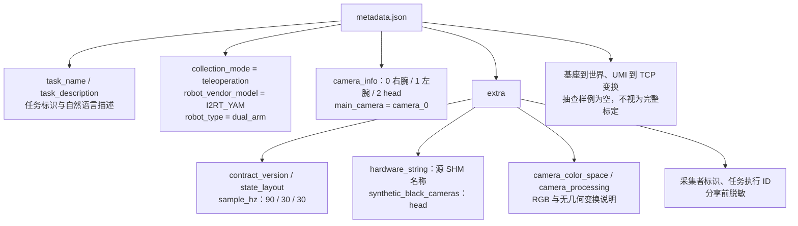

`hardware_config_name=i2rt_dual_bilateral` 是写入器固定描述，**不是完整启动配置快照**；不能据此还原 CAN 接线、夹爪参数或 SDK 版本。

## 10. 录制如何变成一个完成的 episode？

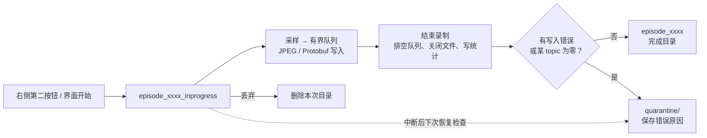

```text
episode_stats.json
├── contract_version               录制契约
├── started_at_ns / ended_at_ns     Unix 纳秒
├── duration_s                     录制生命周期时长
├── topic_counts                   各 topic 成功写入数量
├── dropped_batches                队列满导致的丢批数（不等于消息数）
└── writer_error                   写入异常；null 表示未报告
```

本批 81 条均有 12 路统计、每条 1 个 MCAP 分片，`dropped_batches=0`、`writer_error=null`。这不证明任务成功、无遮挡、无传感器漏帧；尚未逐帧验收全部 MCAP。

## 11. 使用前的边界

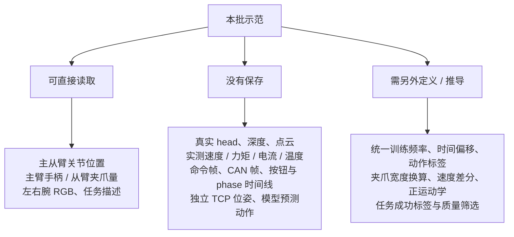

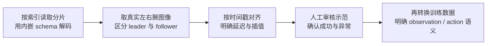

源码：[topic 契约](../consumer/io/nedf3_i2rt_contract.py) · [录制实现](../consumer/io/async_data_saver_i2rt_NEDF3.py) · [离线读取](../consumer/io/i2rt_nedf3_rerun.py) · [控制链路速览](../docs/guide/i2rt_control_and_dataset_guide.md)
