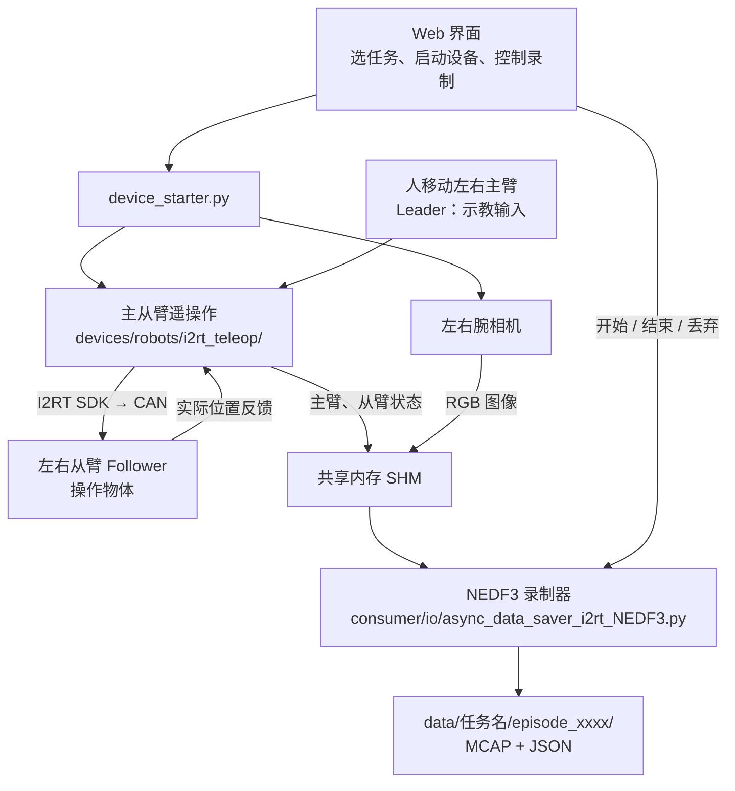
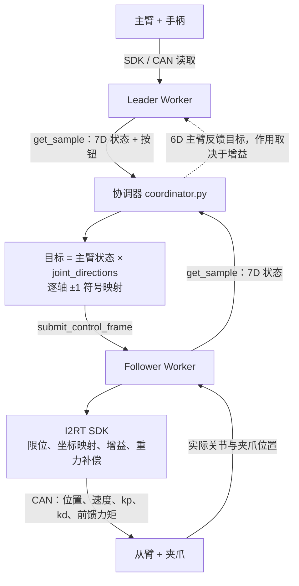
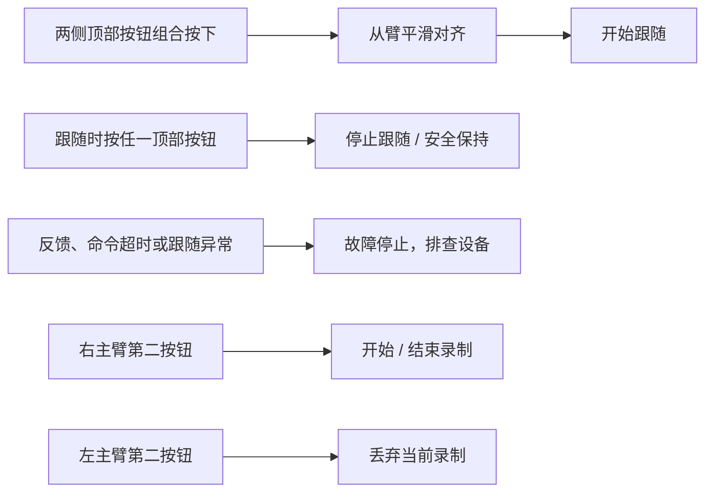
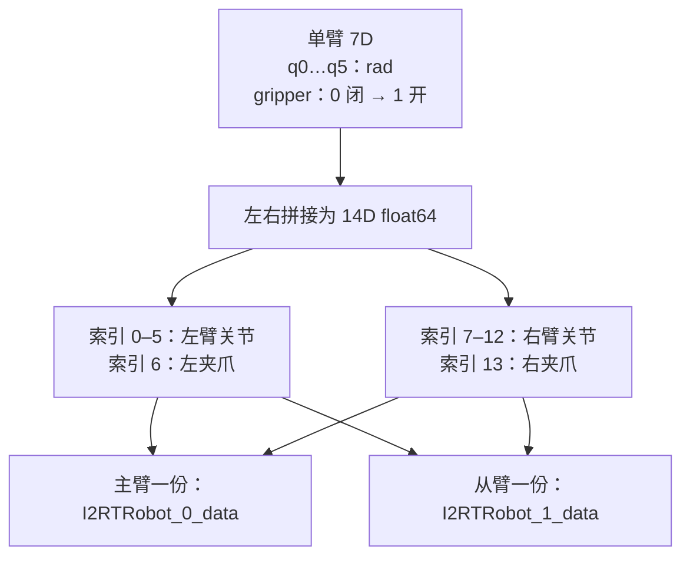
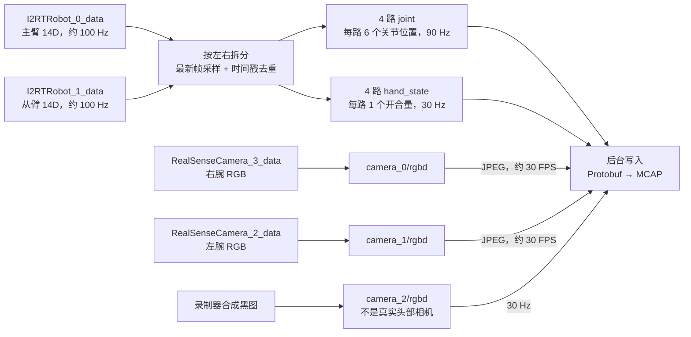
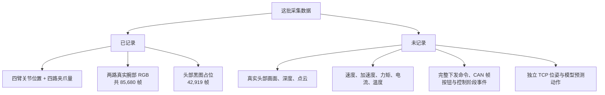

# I2RT 控制与采集速览

Python + I2RT SDK + CAN。下文 topic 是 MCAP 文件通道。**

## 1. 整体链路



这批是**人工遥操作示范**：没有模型参与，录制器不负责驱动机器人。

## 2. 机器人怎么跟随？

下图每侧各一套，左右合计 4 个 Worker；上层目标频率 **100 Hz**。



| RPC 数据 | 字段 |
|---|---|
| 状态 `get_sample` | `state`、`buttons`、`sampled_at_ns`、`phase`、`fault_reason`、`last_applied_sequence` |
| 命令 `submit_control_frame` | `joint_position`（从臂 7D / 主臂 6D）、`session_id`、`sequence`、`issued_at_ns`、`phase` |

> 主臂记录 ≠ 最终下发命令；从臂反馈 ≠ 目标位置。当前默认双向反馈增益为 0。

## 3. 按钮做什么？



**跟随开关与录制开关独立；软件安全保持不等于硬件急停。**

## 4. 每份状态是什么？



## 5. SHM → 文件 topic



完整 **12 个 topic**（名称没有前导 `/`）：

| Topic | 数据 |
|---|---|
| `nmx/nedf/metadata` | 任务、设备与契约信息，每 episode 1 条 |
| `nmx/hal/i2rt/leader/left/joint` | 左主臂关节 |
| `nmx/hal/i2rt/leader/right/joint` | 右主臂关节 |
| `nmx/hal/i2rt/follower/left/joint` | 左从臂关节 |
| `nmx/hal/i2rt/follower/right/joint` | 右从臂关节 |
| `nmx/hal/i2rt/leader/left/hand_state` | 左主臂手柄开合 |
| `nmx/hal/i2rt/leader/right/hand_state` | 右主臂手柄开合 |
| `nmx/hal/i2rt/follower/left/hand_state` | 左从臂夹爪反馈 |
| `nmx/hal/i2rt/follower/right/hand_state` | 右从臂夹爪反馈 |
| `nmx/hal/camera/camera_0/rgbd` | 右腕 RGB |
| `nmx/hal/camera/camera_1/rgbd` | 左腕 RGB |
| `nmx/hal/camera/camera_2/rgbd` | 头部黑图占位 |

```text
joint      → ArmState.joints[0…5] → name + pos（rad）
hand_state → HandState.joints[0]  → name="gripper" + pos（0…1）
rgbd       → RGBD.rgb            → JPEG；depth 为空
```

## 6. 你采了哪些？

| 任务 | 示范数 | 总时长 |
|---|---:|---:|
| `put_banana_in_bowl` | 31 | 8.56 分钟 |
| `put_blue_block_in_blue_cup` | 50 | 15.27 分钟 |
| **合计** | **81** | **23.83 分钟** |



> 统计来自 81 份元数据与统计文件；两个任务各抽查 1 个 MCAP。样例图像为 **640×480 JPEG**，深度为空。统计均未报告丢批或写入错误，但不代表示范全部成功。

## 7. 看数据时只记住三点

- **按时间戳对齐，不按行号**：关节 90 Hz，夹爪/图像约 30 Hz；SHM 时间不代表硬件同步。
- **默认 0 不等于测量值**：消息里的速度、力矩等字段没有写入。
- **配置名不等于历史配置快照**：不要用当前 CAN 编号或旧配置的设备 ID 推断现场接线。

```text
episode_xxxx/
├── metadata.json           任务与设备说明
├── episode_stats.json      时长、消息数、写入错误
└── data/
    ├── mcap_index.json     实际分片索引
    └── data_*.mcap         图像与状态消息
```

源码入口：[协调器](../../devices/robots/i2rt_teleop/coordinator.py) · [硬件端点](../../devices/robots/i2rt_teleop/endpoints.py) · [录制器](../../consumer/io/async_data_saver_i2rt_NEDF3.py) · [topic 契约](../../consumer/io/nedf3_i2rt_contract.py)
