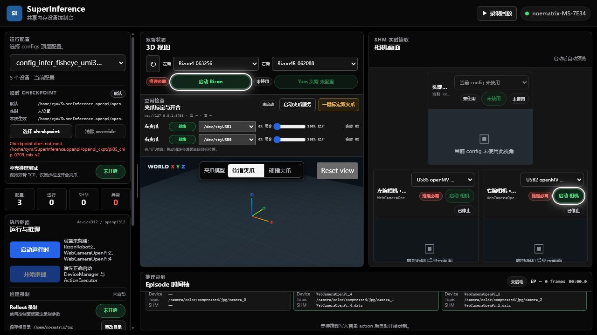
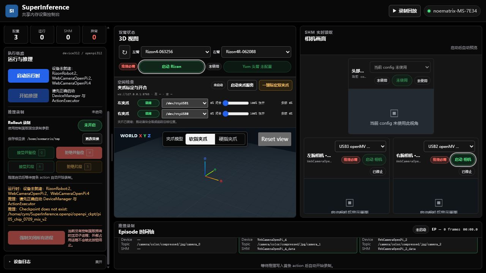
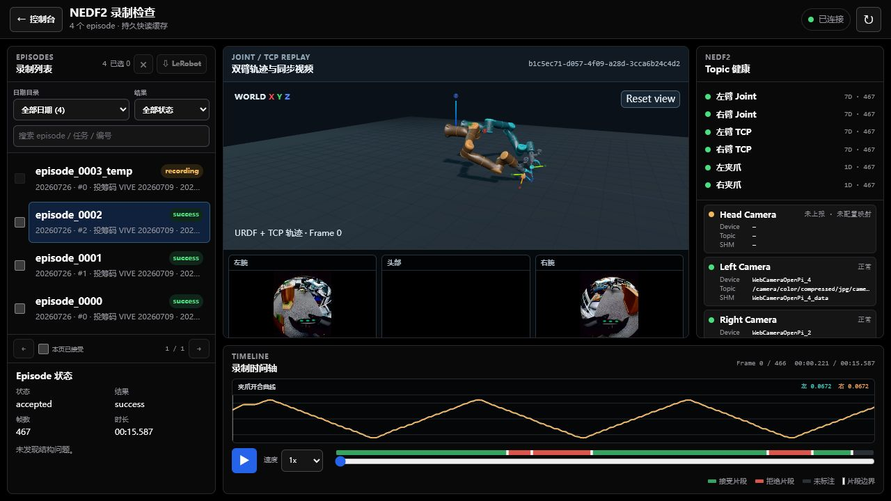

# Control-panel workflow / 可视化面板与推理 Rollout 流程

## Page layout / 页面布局

主页面由互相独立更新的区域组成：

1. **顶部栏**：服务连接状态、进入 `录制回放` 的入口，以及最后手段的
   `强制关闭所有进程`。
2. **左侧控制栏**：config、checkpoint、runtime、inference、Rollout 和
   日志。屏幕高度不足时该栏独立滚动。
3. **中间区域**：Rizon/Yam、夹爪直接控制与标定，以及设备状态。
4. **右侧区域**：固定的头部、左腕、右腕三个相机槽位。下拉框只覆盖对应槽位的
   运行时绑定，不会修改源 config。
5. **底部区域**：当前 episode、语义相机映射、帧数和接收/拒绝片段时间轴。

左栏滚动不会移动相机面板。左栏与主区域之间的竖向分隔线可以拖拽；
聚焦后也可以用键盘方向键调整。

## Controls / 按钮作用

| 控件 | 作用 |
| --- | --- |
| Config 下拉框 | 从 `configs/*.yaml` 组合顶层配置，但不启动硬件。找不到硬件时保留“缺失”停车位供手动选择，不阻止加载 config。 |
| Checkpoint 文件浏览器 | 仅在当前控制面板会话中临时覆盖 `policy.params.ckpt_dir`，不写回 YAML。 |
| 空壳推理测试 | 使用无 checkpoint 的测试策略验证录制：机械臂目标保持不动，夹爪 action 模拟往返开合。它不是模型推理。 |
| Rizon / Yam 下拉框 | 只覆盖对应物理机械臂绑定。缺失槽位不可启动，但不影响选择 config。 |
| 启动 Rizon / Yam | 异步启动对应设备。阶段文本依次报告发现、连接、Home/init 运动和就绪；启动过程中只有页面明确允许时才可再次点击紧急停止。 |
| 夹爪权限授权 | 仅在 ttyUSB 权限不足时申请一次临时授权；夹爪命令由控制面板直接串口 worker 执行，不需要单独启动进程。 |
| 一键标定双夹爪 | 左右夹爪并行标定，完成后重新采样两侧真实位置并对齐 slider。该操作会产生全行程运动。 |
| 夹爪 slider | 拖动期间限频持续追踪该侧目标；左右两侧互不锁定。 |
| 相机下拉框/启动 | 只覆盖并启动该语义槽位。只有 config 把头部相机标成必需时，它才会阻塞推理。 |
| 启动运行时 | 必需设备健康后启动 DeviceManager 和 ActionExecutor；缺失的必需设备或控制面板拥有的故障设备可由流程启动/重启。 |
| 开始推理 | 使用当前有效 checkpoint 和已运行的 SHM runtime 启动 OpenPI policy，不应重载已经健康的设备。 |
| Rollout toggle/目录 | 启用控制面板固化的 Rollout 参数并选择持久录制根目录，不修改 YAML。 |
| 接收/拒绝按钮 | 标记整段或片段。整段复位只暂停推理，按配置的复位流程返回后继续推理并开始下一条，不卸载 runtime 或模型权重。 |
| 暂停/继续推理 | Rollout 关闭时可用。暂停会先禁止新预测、halt 当前执行并清空 action 缓存；继续复用已加载的模型、runtime 和设备，不重新加载权重。 |
| 复位 | Rollout 关闭时可用。暂停推理并执行与整段录制相同的 Home 流程，成功后自动继续推理；失败时保持模型/runtime 常驻且推理维持暂停。 |
| 强制关闭所有进程 | 位于右上角。最后手段，只终止控制面板拥有的子进程；不会优雅复位机械臂，也不能用于外部/古法进程。 |

异步按钮动画只表示前端已经提交请求，不表示硬件就绪。必须结合阶段文本、设备
状态、SHM 数量和相机画面确认完成。夹爪操作完成后短时串口
worker 会释放端口；页面上的夹爪状态来自最近一次直接探测。

## Feature summary / 当前特性

Control Panel 当前覆盖一套完整的设备到 Rollout 工作流：

- **配置管理**：组合和检查 Hydra config，显示 workflow/policy/hardware 元数据，
  支持会话级 checkpoint、设备绑定和运行时参数覆盖。
- **硬件发现与 preflight**：扫描相机、Rizon/Yam、ttyUSB 和网络接口；可选执行
  相机帧、机器人连通性和夹爪状态探测，并在启动前报告阻塞项。
- **夹爪控制**：直接串口 worker、左右端口绑定、权限修复、单侧/双侧位置控制、
  急停和并行标定；标定文件采用原子提交并带有身份/范围校验。
- **相机绑定**：通过发现快照给语义相机槽位绑定实际设备，处理缺失设备、交换和
  stale binding；绑定默认只作用于当前 effective config。
- **运行时生命周期**：按设备、DeviceManager、ActionExecutor、policy 顺序启动，
  对配置、硬件、SHM 和 checkpoint 执行 fail-closed 检查，并只管理本面板拥有的
  子进程。
- **运行时诊断与调参**：提供 policy、ActionExecutor、设备频率/延迟、队列和 SHM
  状态；允许受控修改白名单参数，并校验 config/revision 上下文。
- **Generated config**：将当前 effective config、端口绑定、调参和校准快照导出为
  隔离配置，不覆盖源 YAML；导出过程支持安全路径检查和原子发布。
- **Rollout 与回放**：支持录制目录、episode 接收/拒绝、片段标记、暂停/继续、
  Home 复位、相机/轨迹回放和 NEDF3 数据契约。
- **独立装配查看器**：`scripts/visualization/visualize_flexiv_assembly.py` 独立于
  控制面板显示两台 Rizon 的物理网格、法兰坐标系和工具坐标系；可从 Flexiv RDK
  读取当前关节与 `tcp_location`，也可用 `--offline` 检查模型。LK 夹爪目前使用
  参数化近似几何，因为仓库没有 LK URDF/CAD。

### Persistence boundary / 持久化边界

配置下拉框、相机/夹爪绑定、checkpoint 和运行时调参首先更新当前 session 的
effective config。它们不会自动覆盖仓库中的源 YAML；需要持久化时，使用
Generated config 导出，或由维护者明确修改源配置。夹爪 calibration JSON 在完成
校准事务时会原子写入，但它不等于自动修改源 YAML 中的设备绑定。

## Startup sequence / 启动推理与 Rollout

1. 确认右上角控制面板状态为已连接。
2. 选择目标 config，检查必需/可选标记；通过各设备下拉框修正缺失或错误绑定。
3. 确认“本次生效”的 checkpoint。只有需要临时覆盖时才选择新路径；无模型测试
   必须明确打开“空壳推理测试”。
4. 启动全部必需硬件。Rizon、Yam 和各相机按需启动；夹爪不需要单独启动服务，
   首次控制或标定前按页面提示完成 ttyUSB 权限授权即可。
5. 等待真实就绪：机械臂状态必须新鲜，必需相机必须有画面，必需 SHM producer
   必须存在。
6. 点击 `启动运行时`，等待 DeviceManager 和 ActionExecutor 就绪。
7. 需要采集时打开 `Rollout 录制` 并选择录制根目录；关闭 toggle 时仍可推理，
   但控制面板 recorder 不启动。
8. 点击 `开始推理`。收到第一条 action 后才真正开始录制，模型加载阶段不会提前
   产生空 episode。
9. 录制中按按钮所示的品字形快捷键操作：`Q` 接收并复位、`W` 拒绝并复位、
   `A` 接收片段、`S` 拒绝片段。片段操作只写时间轴标记，不卸载 runtime/policy。
10. 停止设备前先停止推理，再停止 runtime；使用正常停止并等待页面完成复位和
    清理阶段。

Rollout 关闭时，四按钮区域替换为左右等宽的 `暂停/继续推理` 与橙色 `复位`
按钮。两者都保持 runtime、设备进程和模型权重常驻；复位复用同一套 Home
candidate 流程且不会启动 recorder。复位失败不会停止 Rizon worker 或 runtime，
页面会保持“推理已暂停”，操作者排除问题后可重试复位或明确点击继续。
双臂 Rizon 的复位运动采用分段直线 TCP 路径，详见
[双臂直线 TCP 复位](cartesian-home-reset.md)。

## Recording replay / 数据回放

点击顶部 `录制回放` 进入 `/recordings`，回放页左上角可返回控制台。

回放页支持按日期/结果筛选和展开 episode，同步播放已有相机视频与 joint/URDF 或
TCP 轨迹，显示夹爪曲线，并在时间轴叠加接收/拒绝片段。没有 joint 的旧数据只要
存在 TCP 和视频仍可回放相应内容。Incomplete episode 可以检查，但不会被当成
已 finalize 且可训练的 accepted 数据。
