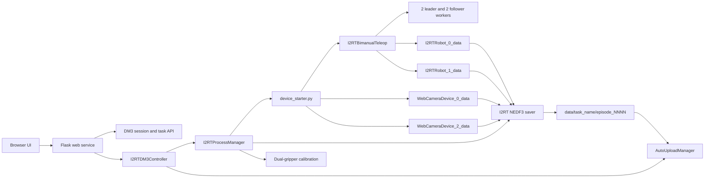

# I2RT NEDF3 Data Collection

This package provides the browser interface for collecting and uploading NEDF3
episodes from the I2RT dual-arm teleoperation rig. It covers DM3 login and task
selection, device startup, gripper calibration, episode recording, and upload.

The web server does not open hardware when it starts. Devices move only after an
operator selects a task and starts the device stack from the collection page.

## Collection Architecture



### Process ownership

- The web process owns the DM3 session, UI state, upload manager, and child
  process lifecycle.
- `device_starter.py` owns all physical devices. It starts one composite
  `I2RTBimanualTeleop`, two wrist cameras, and the teleoperation workers.
- The composite I2RT device publishes both robot streams. The follower entry in
  the device YAML is marked `managed_by` and does not start a second robot.
- The saver only reads shared memory. It never opens a CAN or serial device.
- Gripper calibration is a separate process and can run only while the device
  and saver processes are stopped.
- The upload manager scans the managed `data/` root and uses `i2rt` as its DM3
  `resource_type`.

## Important Files

| File | Purpose |
| --- | --- |
| `incubator/nedf3/I2RT_DM3/web/` | Flask server, HTML, CSS, and browser-side controls |
| `incubator/nedf3/I2RT_DM3/controller.py` | Connects DM3 sessions, task metadata, processes, and uploads |
| `incubator/nedf3/I2RT_DM3/process_manager.py` | Starts, monitors, logs, and stops device, saver, and calibration processes |
| `configs/i2rt_data_collect_async.yaml` | Top-level DeviceStarter profile and camera bindings |
| `configs/devices/i2rt_bimanual_collection.yaml` | Composite I2RT and two-camera SHM contracts |
| `configs/i2rt_bimanual_teleop.yaml` | CAN channels, RPC ports, control settings, and gripper backends |
| `configs/i2rt_nedf3_saver.yaml` | Recorder frequency, queue, JPEG, SHM, and synthetic-camera settings |
| `consumer/io/async_data_saver_i2rt_NEDF3.py` | Terminal recorder and SHM-to-NEDF3 conversion |
| `consumer/io/nedf3_i2rt_contract.py` | Canonical topic list and NEDF3 writer metadata |
| `consumer/io/i2rt_nedf3_rerun.py` | Streaming MCAP reader and Rerun visualization |
| `scripts/visualization/i2rt_nedf3_rerun.py` | Saved-episode visualization CLI |
| `scripts/calibration/calibrate_i2rt_grippers.py` | Calibrates both configured LKTech grippers |

## Shared-Memory Schema

The device stack publishes these streams before the saver can start:

| SHM name | Shape and dtype | Layout |
| --- | --- | --- |
| `I2RTRobot_0_data` | `(14,) float64` | Leader: left joints 0-5, left gripper, right joints 0-5, right gripper |
| `I2RTRobot_1_data` | `(14,) float64` | Follower: left joints 0-5, left gripper, right joints 0-5, right gripper |
| `WebCameraDevice_0_data` | `(360, 640, 3) uint8` | Left wrist RGB image |
| `WebCameraDevice_2_data` | `(360, 640, 3) uint8` | Right wrist RGB image |

The current rig has no physical head camera. The saver generates a black
`(480, 640, 3) uint8` head image at the recorder sample rate so every episode
still satisfies the complete NEDF3 camera contract.

Before JPEG encoding, each 640x360 wrist frame is center-cropped by removing
185 pixels from both the left and right edges. The resulting 270x360 image is
resized to 480x640 (W x H), so wrist images are stored as `(640, 480, 3)` HWC.
The synthetic head image is stored at 640x480 (W x H), or `(480, 640, 3)` HWC.

## NEDF3 Schema

The contract version is `i2rt-nedf3-v2`. The saver records arm states at 90 Hz
and gripper and camera topics at 30 Hz. It JPEG-encodes RGB frames at quality 90
by converting the RGB shared-memory image to OpenCV's BGR encoder input. It
records the following exact topics:

| Topic | Protobuf payload | Content |
| --- | --- | --- |
| `nmx/nedf/metadata` | `Metadata` | Episode, task, operator, hardware, and contract metadata |
| `nmx/hal/camera/camera_0/rgbd` | `RGBD` | Right wrist JPEG RGB; empty depth |
| `nmx/hal/camera/camera_1/rgbd` | `RGBD` | Left wrist JPEG RGB; empty depth |
| `nmx/hal/camera/camera_2/rgbd` | `RGBD` | Synthetic black head JPEG RGB; empty depth |
| `nmx/hal/i2rt/leader/right/joint` | `ArmState` | Six `JointState` entries named `joint0` through `joint5` |
| `nmx/hal/i2rt/leader/right/hand_state` | `HandState` | One joint named `gripper` |
| `nmx/hal/i2rt/leader/left/joint` | `ArmState` | Six leader arm joints |
| `nmx/hal/i2rt/leader/left/hand_state` | `HandState` | One leader gripper value |
| `nmx/hal/i2rt/follower/right/joint` | `ArmState` | Six follower arm joints |
| `nmx/hal/i2rt/follower/right/hand_state` | `HandState` | One follower gripper value |
| `nmx/hal/i2rt/follower/left/joint` | `ArmState` | Six follower arm joints |
| `nmx/hal/i2rt/follower/left/hand_state` | `HandState` | One follower gripper value |

The historical `/joint` topic spelling is part of the dataset contract. Its
payload contains six joints; it is not a Cartesian pose.

Each episode metadata record includes the selected DM3 task, task description,
user ID, user name, task execution ID, state layout, hardware stream names, and
the list of synthetic cameras.

### Episode lifecycle

Episodes are first written as:

```text
data/<sanitized-task-name>/episode_0000_inprogress/
```

After finalization, the directory becomes `episode_0000`. It contains the NEDF3
metadata and MCAP data produced by `dm3-core`, plus `episode_stats.json` with
duration, per-topic counts, dropped batches, and writer errors.

- A discarded episode is deleted.
- An episode with a writer error or any missing canonical topic moves to
  `quarantine/` with `quarantine_reason.json`.
- An `_inprogress` directory found after an interrupted recorder is moved to
  `quarantine/` when the next episode starts.

### Visualize a saved episode

The Rerun visualizer reads finalized MCAP shards without opening robot or camera
hardware. It shows the three synchronized camera streams, all leader/follower
joint positions, and all four gripper values. Camera JPEGs remain encoded while
streaming, so a full episode is not expanded into memory before visualization.
For `i2rt-nedf3-v1` Episodes, it repairs the historical red/blue channel swap
while streaming. `i2rt-nedf3-v2` Episodes are displayed directly from their
correctly encoded JPEG payloads.

Run it through the verified recording profile:

```bash
python3 scripts/diagnostics/runtime_profiles.py run \
  --config-name i2rt_d405_yam_collect_async --role recording -- \
  scripts/visualization/i2rt_nedf3_rerun.py \
  'data/<task-name>/episode_0000'
```

Omit the episode path to select the newest finalized episode below `data/`, or
use `--data-dir 'data/<task-name>'` to limit that search. To create a portable
Rerun recording without opening the viewer, add `--output episode_0000.rrd`.
The recording profile must include `rerun-sdk==0.22.1`; newer Rerun releases
require NumPy 2.x and conflict with the approved NumPy 1.26.4 NEDF3 environment.
After all hardware and recording processes have stopped, the collection page
provides an Episode folder picker that can open any finalized Episode below
`data/` in Rerun.

## Website Structure

The browser interface has three views.

### 1. Login and task selection

1. Log in to DM3 with the operator account.
2. Fetch task executions, optionally filtering by date.
3. Select one task before opening collection controls.
4. The selected task name determines the output directory under `data/` and is
   written into episode metadata.

### 2. Data collection

The collection page shows device, teleoperation, saver, calibration, and episode
status. It provides controls for:

- Calibrating both LKTech grippers while all collection processes are stopped.
- Starting and stopping the DeviceStarter-owned hardware stack.
- Starting and stopping the NEDF3 saver after device streams are live.
- Starting/finalizing or discarding an episode from the browser.
- Monitoring right wrist, left wrist, and synthetic head frames from the
  existing shared-memory streams without opening the cameras a second time.
  Wrist previews use latest-frame MJPEG at up to 30 FPS, the original 640x360
  image, JPEG quality 90, and explicit RGB-to-BGR conversion.
- Viewing separate device, saver, and calibration logs.

The leader-arm buttons remain available during collection:

- Press both top buttons within the configured chord window to enable motion.
- Keep clear of the leader arms while they hold their trigger positions and the
  followers align; the hold releases automatically when teleoperation becomes active.
- Press either top button to return to safe hold.
- Press the right second button to start or finalize an episode.
- Press the left second button to discard the active episode.

Stopping order is enforced: stop the saver before stopping devices. A watchdog
fault blocks new episodes while still allowing the active episode to be
finalized or discarded.

### 3. Upload

The upload view scans task episode directories, reports queue and resource
usage, and supports:

- Automatic upload after episode finalization.
- Uploading currently eligible episodes.
- Retrying failed uploads.
- Explicitly confirmed forced upload of all episodes.
- Retention, retry, worker, and multipart-thread settings.

## Start the Web UI

From the repository root:

```bash
source .venv/bin/activate
python -m incubator.nedf3.I2RT_DM3.web --host 127.0.0.1 --port 8080
```

Open <http://127.0.0.1:8080>. Stop the server with `Ctrl+C`; shutdown also stops
managed saver, device, calibration, and upload processes.

The collection page loads its selectable system combinations from the tracked
`configs/i2rt_system_profiles.yaml` manifest. The manifest contains the LKTech
plus dual-fisheye rig, the original YAM plus dual-D405 rig, and the original YAM
plus three-D405 rig. Camera and LKTech serial selections are stored only in the Git-ignored machine-local
`.superinference/local/i2rt_hardware_bindings.json` file. Before every profiled
device start or LKTech calibration, the backend enumerates the hardware again
and rejects a missing path, duplicate physical device, changed udev identity,
or stale profile revision.

The browser never accepts or writes CAN interface roles. Configure the four CAN
roles and their expected adapter serials locally before launching the service;
startup continues to validate adapter identity, link state, and bitrate. The
generated LKTech teleoperation snapshot is also machine-local under
`.superinference/local/i2rt_launches/` and does not modify tracked YAML.

The server binds to loopback by default. For access from another computer, keep
that binding and create an SSH tunnel:

```bash
ssh -L 8080:127.0.0.1:8080 ubuntu@<robot-host>
```

Then open <http://127.0.0.1:8080> on the client computer. Direct non-loopback
binding requires the explicit `--allow-remote` option and should only be used on
a trusted network.

### D405 cameras and YAM grippers

The separate `i2rt_d405_yam_*` configs keep the original rig unchanged. They
use two RealSense D405 wrist RGB streams at 640x360 and one head RGB stream at
640x480, all at 30 fps. The head stream is saved as NEDF3 `camera_2`; the rig
uses the I2RT CAN gripper backend. Identify all three camera serials before
starting devices:

```bash
.venv/bin/python -c 'import pyrealsense2 as rs; print([(d.get_info(rs.camera_info.name), d.get_info(rs.camera_info.serial_number)) for d in rs.context().query_devices()])'
export SI_I2RT_LEFT_RS_SERIAL=<left-wrist-D405-serial>
export SI_I2RT_RIGHT_RS_SERIAL=<right-wrist-D405-serial>
export SI_I2RT_HEAD_RS_SERIAL=<head-D405-serial>
```

The browser profile flow saves the two D405 serials in the machine-local
hardware binding. The environment variables remain supported by the legacy
command-line/empty-request launch path. Run the browser through the verified
runtime profile so its device subprocess also inherits the locally configured
CAN identity confirmations.

The new rig uses `crank_4310` on both YAM followers. The configuration selects
this type, and the browser checks the matching confirmation variable before
device startup. The mapped CAN interfaces are left leader `can1`, left follower
`can3`, right leader `can0`, and right follower `can2`. Unlike the old machine,
these interfaces currently use kernel-assigned names, which may change after
replugging; confirm cable identity and set all four links to 1 Mbit/s before
starting devices. The browser also rejects missing or disconnected D405 serials:

```bash
export SI_I2RT_YAM_GRIPPER_TYPE=crank_4310
```

Check the current CAN interface state without sending motor commands:

```bash
for iface in can0 can1 can2 can3; do ip -details link show "$iface"; done
```

The new mode also requires these machine-local serial bindings, matched to the
corresponding `canN` adapters. Store them in the runtime profile or export them
before launching the browser:

```bash
export SI_I2RT_CAN_LEADER_LEFT_SERIAL=<can1-ID_SERIAL>
export SI_I2RT_CAN_FOLLOWER_LEFT_SERIAL=<can3-ID_SERIAL>
export SI_I2RT_CAN_LEADER_RIGHT_SERIAL=<can0-ID_SERIAL>
export SI_I2RT_CAN_FOLLOWER_RIGHT_SERIAL=<can2-ID_SERIAL>
```

Startup rejects a swapped adapter, a down interface, or a bitrate other than
1 Mbit/s. Recheck the mapping whenever an adapter is moved to another USB port.

Start the browser service without opening devices, using the verified profile:

```bash
python3 scripts/diagnostics/runtime_profiles.py doctor \
  --config-name i2rt_d405_yam_collect_async
python3 scripts/diagnostics/runtime_profiles.py run \
  --config-name i2rt_d405_yam_collect_async --role launcher -- \
  -m incubator.nedf3.I2RT_DM3.web \
  --device-config i2rt_d405_yam_collect_async \
  --saver-config configs/i2rt_d405_yam_saver.yaml
```

The LKTech calibration control is unavailable in this mode. The D405 browser
and devices use the verified `launcher`/`device` profile; the saver requires a
separate verified `recording` profile bound to
`i2rt_d405_yam_collect_async`. The I2RT driver requires NumPy 2.2.6, while the
approved NEDF3 recording profile pins NumPy 1.26.4. Install the private
`dm3-core==0.2.18` and `nmx-msg==2.2.0` wheels into a Python 3.12 recording
environment, then register, bind, verify, and run `doctor` through
`scripts/diagnostics/runtime_profiles.py`. Do not use an older `dm3-core` wheel
for this recorder. A wheelhouse is the directory containing those `.whl` files. On the
original recorder machine, locate the active interpreter and any retained wheels
without stopping collection:

```bash
ps -eo pid,args | rg 'async_data_saver_i2rt_NEDF3|I2RT_DM3'
find /home /opt /mnt -type f \( -iname 'dm3_core*.whl' -o -iname 'nmx_msg*.whl' \) -print 2>/dev/null
```

Use the interpreter shown by the first command to inspect installed versions:

```bash
/path/to/recording/python -c 'from importlib import metadata; print({name: metadata.version(name) for name in ("dm3-core", "nmx-msg")})'
```

If the wheel files are absent, download the approved artifacts from the internal
Nexus service. Keep them under the ignored local runtime directory:

```bash
NEDF_WHEELHOUSE="$PWD/.superinference/local/nedf3-wheelhouse"
mkdir -p "$NEDF_WHEELHOUSE"
curl -fL -o "$NEDF_WHEELHOUSE/dm3_core-0.2.18-py3-none-any.whl" \
  'https://pypi-cloud.noematrix.cn/repository/pypi-releases/packages/dm3-core/0.2.18/dm3_core-0.2.18-py3-none-any.whl'
curl -fL -o "$NEDF_WHEELHOUSE/nmx_msg-2.2.0-py3-none-any.whl" \
  'https://pypi-cloud.noematrix.cn/repository/pypi-group/packages/nmx-msg/2.2.0/nmx_msg-2.2.0-py3-none-any.whl'
sha256sum "$NEDF_WHEELHOUSE"/*.whl
```

The expected SHA-256 values are
`1292b6175fea517bbeb1acb4eaa43353151cef41964460b92c75495c9362a8cc`
for `dm3-core` and
`fe7b674919c5ea744e076f86ae4ad549d5b28e99b58ac1a4a5bbba3d76716584`
for `nmx-msg`. Installed packages alone do not establish a portable wheel
artifact. The maintained source installer
`incubator/control_panel/release/install_source_recording_profile.sh` requires
Python 3.12 and the approved wheelhouse; a `cp312` wheel cannot be installed into
this checkout's Python 3.10 development environment.

After placing both approved wheels in one local directory, set
`NEDF_WHEELHOUSE` to its absolute path and configure the separate recorder:

```bash
uv python install 3.12
uv venv .superinference/local/i2rt-recording --python 3.12
incubator/control_panel/release/install_source_recording_profile.sh \
  "$PWD/.superinference/local/i2rt-recording/bin/python" "$NEDF_WHEELHOUSE"
python3 scripts/diagnostics/runtime_profiles.py register i2rt-nedf3-recording \
  --python .superinference/local/i2rt-recording/bin/python \
  --import dm3_core.nedf --import dm3_core.mcap --import nmx_msg \
  --import consumer.io.async_data_saver_i2rt_NEDF3
python3 scripts/diagnostics/runtime_profiles.py bind \
  --config-name i2rt_d405_yam_collect_async --role recording \
  --profile i2rt-nedf3-recording
python3 scripts/diagnostics/runtime_profiles.py verify \
  --profile i2rt-nedf3-recording
python3 scripts/diagnostics/runtime_profiles.py doctor \
  --config-name i2rt_d405_yam_collect_async
```

## Terminal-Only Collection

The web interface runs these same components as managed subprocesses. For
diagnostics or minimal collection, use two terminals.

Terminal 1, start all devices and teleoperation:

```bash
source .venv/bin/activate
python device_starter.py --config-name i2rt_data_collect_async
```

Wait until both robot streams and both camera streams report ready. Terminal 2,
start the saver:

```bash
source .venv/bin/activate
python -m consumer.io.async_data_saver_i2rt_NEDF3 \
  --config configs/i2rt_nedf3_saver.yaml
```

Saver keyboard controls:

- `Enter`: start or finalize an episode.
- `d` then `Enter`: discard the active episode.
- `q` then `Enter`: finalize if needed and exit.

For a fixed-duration smoke recording after devices are ready:

```bash
python -m consumer.io.async_data_saver_i2rt_NEDF3 \
  --config configs/i2rt_nedf3_saver.yaml \
  --auto-start --duration 10
```

## Calibration and Hardware Checks

Stop DeviceStarter and the saver before calibrating:

```bash
python scripts/calibration/calibrate_i2rt_grippers.py \
  --config configs/i2rt_bimanual_teleop.yaml \
  --side both
```

Confirm the serial devices configured in `configs/i2rt_bimanual_teleop.yaml`:

```bash
ls -l /dev/ttyUSB0 /dev/ttyUSB1
```

Confirm all four named interfaces are real SocketCAN devices. Kernel CAN type is
`280`; loopback type `772` indicates a naming collision and must not be used:

```bash
for iface in can_leader_l can_leader_r can_follower_l can_follower_r; do
  printf '%s: ' "$iface"
  cat "/sys/class/net/$iface/type"
done
```

Inspect CAN state and bitrate without commanding a robot:

```bash
ip -details link show can_leader_l
ip -details link show can_leader_r
ip -details link show can_follower_l
ip -details link show can_follower_r
```

Camera paths can be overridden without editing YAML:

```bash
export SI_I2RT_LEFT_CAMERA=/dev/v4l/by-id/<left-camera>-video-index0
export SI_I2RT_RIGHT_CAMERA=/dev/v4l/by-id/<right-camera>-video-index0
python device_starter.py --config-name i2rt_data_collect_async
```

## Useful Verification Commands

Check that the web server is alive:

```bash
curl http://127.0.0.1:8080/api/health
```

Run the hardware-free collection, watchdog, and web tests:

```bash
pytest -q \
  tests/devices/test_i2rt_configurable_teleop.py \
  tests/devices/test_i2rt_teleop_watchdog.py \
  tests/devices/test_device_starter_managed_streams.py \
  tests/incubator/test_i2rt_hardware_bindings.py \
  tests/incubator/test_i2rt_dm3.py \
  tests/incubator/test_i2rt_dm3_web.py
```

Initialize the exact dependency revisions recorded by the project after cloning:

```bash
git submodule update --init --recursive
```

Use the pinned submodule command above for reproducible setup. Avoid
`git submodule update --remote` unless intentionally updating dependency
revisions and committing the resulting gitlinks.

## Operational Notes

- Required runtime packages include `dm3-core`, `nmx-msg`, Flask, OpenCV,
  NumPy, PyYAML, psutil, Portal, and the checked-out I2RT/LKTech submodules.
- The web server adds CSRF checks to control requests and sends no-cache, CSP,
  no-referrer, no-sniff, and frame-denial headers.
- DM3 login and task selection are required before saving data. Gripper
  calibration additionally requires the device and saver processes to be idle.
- Device startup validates all configured CAN names before constructing hardware
  endpoints. Missing interfaces or non-CAN name collisions fail immediately.
- Do not run a standalone teleoperation script while DeviceStarter owns the rig;
  two processes must never open the same CAN or serial devices.
